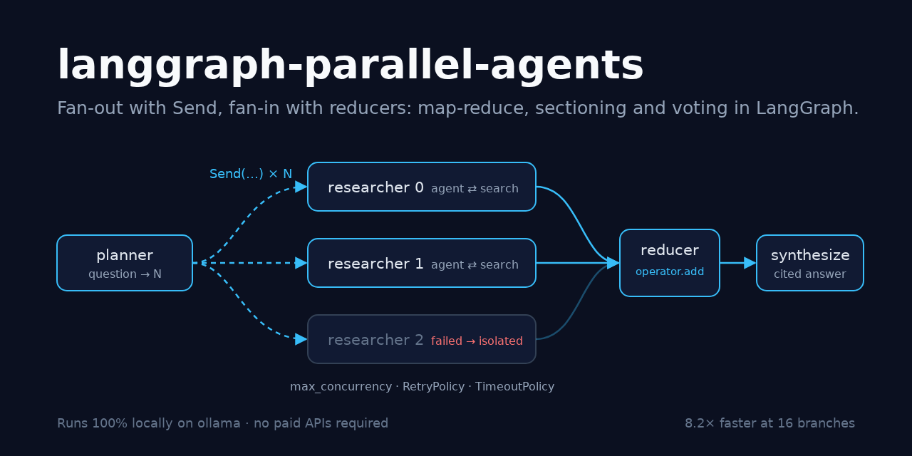
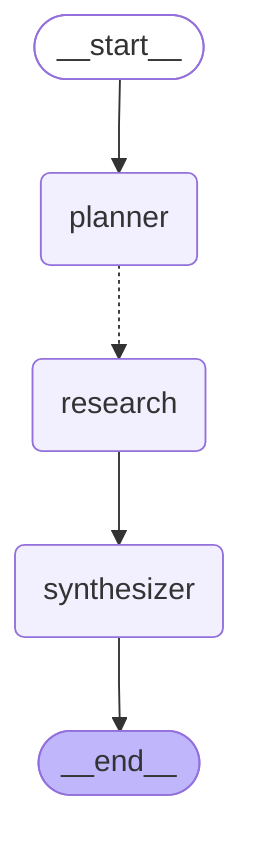
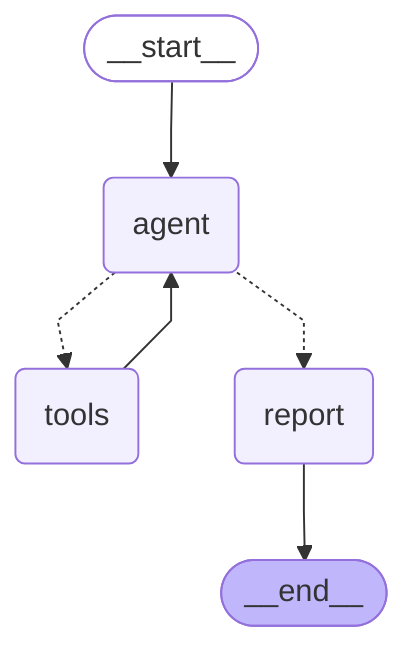
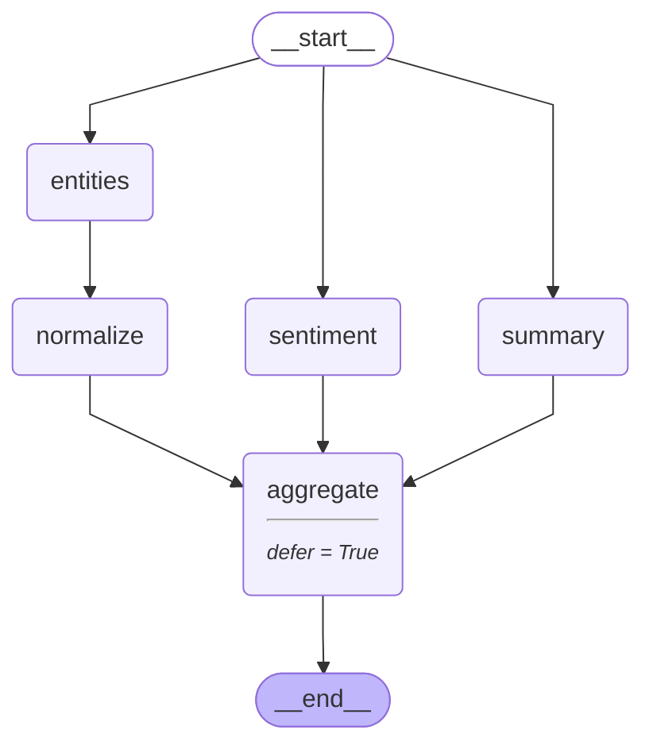

# langgraph-parallel-agents

> Parallel agents in LangGraph, done properly: a map-reduce research desk that fans out
> with `Send` to tool-using researcher subgraphs and fans back in through a reducer,
> plus sectioning and voting. Concurrency is bounded, each branch has its own retries,
> timeouts and failure isolation, progress streams per branch, and a benchmark measures
> the speed-up.

[](https://github.com/MartinCastroAlvarez/langgraph-parallel-agents/actions/workflows/ci.yml)
[](LICENSE)
[](pyproject.toml)
[](https://github.com/langchain-ai/langgraph)
[](pyproject.toml)



**Runs 100% locally, no paid APIs required.** The default model is an open-weight model
on [ollama](https://ollama.com) (`qwen3:4b`) through `langchain-ollama`. The researchers
search a bundled public-domain corpus (the US Constitution and Sun Tzu's *Art of War*)
with a local BM25 index, so there is no web search either. Anthropic is an optional
adapter you can switch on with your own key. The tests and the benchmark use a fake chat
model and need no model, no key and no network.

## Why

- **Agents are slow because models are slow.** A desk that researches 16 sub-questions
  one after another waits on 34 model calls. Run the branches in parallel and you wait on
  the slowest one. In the benchmark below that's 8.7 s down to 1.1 s.
- **Fan-out is easy; fan-in is where bugs live.** Parallel branches writing the same
  state key need a reducer (`Annotated[list, operator.add]`), deterministic ordering,
  and a join that fires once. This repo shows all three, with tests.
- **One bad branch shouldn't sink the run.** In langgraph 1.2.17 a `Send` branch that
  raises aborts the whole superstep, and `error_handler` doesn't help once siblings run
  in parallel (pinned in [`tests/test_upstream.py`](tests/test_upstream.py)). Here, each
  branch retries inside its own subgraph and comes back as data either way.
- **Parallelism needs a ceiling.** Local GPUs and rate-limited APIs both fall over when
  you fire 50 requests at once. `max_concurrency` in the run config caps it, and the fake
  model's peak-in-flight gauge proves the cap holds.

## Quickstart

```bash
pip install "langgraph-parallel-agents @ git+https://github.com/MartinCastroAlvarez/langgraph-parallel-agents"
ollama pull qwen3:4b
python -m parallel_agents "What powers does the Constitution give to Congress, the President and the courts?"
python -m parallel_agents --provider fake "What does the corpus say about spies, fire and terrain?"   # no ollama needed
python -m parallel_agents.bench                                                                       # the speed-up table
```

`--pattern sectioning "<text>"` and `--pattern voting "<question>"` run the other two
graphs, and `--mermaid research` prints a graph. `python -m examples.quickstart` runs all
three patterns offline.

```text
$ python -m parallel_agents --provider fake --latency 0.2 "What powers does the Constitution give to Congress, the President and the courts?"
[  0.203s] graph            plan   sub_questions=['What powers does the Constitution give to Congress?', 'What powers does the Constitution give to the President?', 'What powers does the Constitution give to the courts?']
[  0.205s] branch 0         start  task='What powers does the Constitution give to Congress?'
[  0.205s] branch 1         start  task='What powers does the Constitution give to the President?'
[  0.205s] branch 2         start  task='What powers does the Constitution give to the courts?'
[  0.409s] branch 0         tool   query='What powers does the Constitution give to Congress?'
[  0.409s] branch 1         tool   query='What powers does the Constitution give to the President?'
[  0.409s] branch 2         tool   query='What powers does the Constitution give to the courts?'
[  0.618s] branch 0         done   seconds=0.415
[  0.618s] branch 1         done   seconds=0.414
[  0.619s] branch 2         done   seconds=0.415

All legislative Powers herein granted shall be vested in a Congress of the United States, ... [us-constitution:article-1-section-1]
In Case of the Removal of the President from Office, ... [us-constitution:article-2-section-1-p4]
The judicial Power of the United States, shall be vested in one supreme Court, ... [us-constitution:article-3-section-1]

Sources:
  [1] us-constitution:article-1-section-1
  [2] us-constitution:article-2-section-1-p4
  [3] us-constitution:article-3-section-1
```

That transcript is a real run with the **fake** model (the answer, one line in the
terminal, is wrapped and shortened with `...`). The three
branches start together and finish together, and the citations are real passage ids
from BM25. The fake model's prose is the first sentence of the top passage, so the
President branch quotes the removal clause rather than Article 2, Section 2. That's a
BM25 ranking you'd also get with a real model. With ollama, the planner and researchers
write their own sub-questions and summaries.

## The three patterns

### 1. Map-reduce: the research desk (`Send` + reducer)



Each `research` task runs this researcher subgraph, a small ReAct loop over one tool:



Both diagrams are `get_graph().draw_mermaid()` output, pasted unchanged
(`python -m parallel_agents --mermaid research` and `--mermaid researcher`). The dotted
`planner -.-> research` edge is the `Send` fan-out:

```python
class DeskState(TypedDict, total=False):
    question: str
    sub_questions: list[str]
    findings: Annotated[list[Finding], operator.add]        # the fan-in
    failures: Annotated[list[BranchFailure], operator.add]
    answer: str

def fan_out(state: DeskState) -> list[Send]:
    return [Send("research", {"index": i, "sub_question": q})
            for i, q in enumerate(state["sub_questions"])]

graph.add_conditional_edges("planner", fan_out, ["research"])
graph.add_edge("research", "synthesizer")
...
await desk.ainvoke({"question": q}, {"max_concurrency": 4})
```

- **Planner.** Asks the model for a JSON array of sub-questions. `parse_plan` accepts
  JSON or a numbered list, de-duplicates, and caps the count (`max_branches`) and the
  length of each one. It is never empty: the fallback is the question itself.
- **Researcher.** A compiled `StateGraph`: `agent` (the model with `search_corpus` bound
  via `bind_tools`) ⇄ `ToolNode`, at most `max_tool_steps` rounds, then `report`.
  `report` keeps only citations to passages the branch actually retrieved, and deletes
  invented ones from the text too.
- **Reducer.** Every branch returns `{"findings": [finding]}`. `operator.add`
  concatenates them, and LangGraph applies parallel writes in task order, not
  completion order. The synthesizer still sorts by `index`, so the answer is
  byte-identical however the branches finish (tested with random latencies).
- **Synthesizer.** Writes the cited answer from the numbered findings, names the
  sub-questions that failed, and drops any citation that isn't in a finding.

### 2. Sectioning: static fan-out + deferred join

The same text goes to three specialists at once. The entities branch is two steps long
on purpose:



Without `defer=True`, `aggregate` fires when `sentiment` and `summary` finish (superstep
2) and again after `normalize` (superstep 3), so it runs twice, the first time on half
the data. `add_node("aggregate", aggregate, defer=True)` holds it until nothing else is
pending. `tests/test_sectioning.py` asserts one run with `defer` and two without.

### 3. Voting: N samples → majority

`Send` fans out `samples` copies of the same question; each vote lands in
`votes: Annotated[list[Vote], operator.add]`; `tally` normalises answers (`"Two."`,
`"two"` and `"2"` count as one), picks the majority, and breaks ties by the earliest
sample index, never by arrival order. It reports `agreement` and whether a strict
majority (`consensus`) was reached. With ollama the CLI raises the temperature to 0.7
for this pattern, since identical samples would make the vote pointless.

## Production concerns, and where they live

| Concern | How | Where |
| --- | --- | --- |
| Bounded concurrency | `config={"max_concurrency": k}` caps tasks per superstep; it also applies inside each subgraph | `Settings.run_config()`, `--max-concurrency` |
| Retries | `RetryPolicy(max_attempts=n, initial_interval=0.05, max_interval=2)` on every model-calling node. LangGraph's default `retry_on` retries connection errors, 5xx and node timeouts, and doesn't retry `ValueError`/`RuntimeError`-style bugs | `isolation.branch_retry_policy` |
| Per-call timeout | `add_node(..., timeout=TimeoutPolicy(run_timeout=...))`. The attempt is cancelled and raises `NodeTimeoutError`, which the retry policy retries | `PARALLEL_AGENTS_CALL_TIMEOUT` |
| Per-branch budget | `asyncio.timeout` around the whole branch subgraph, retries included | `PARALLEL_AGENTS_BRANCH_TIMEOUT` |
| Failure isolation | the node that `Send` targets runs the branch subgraph through `run_isolated`, which turns any leftover exception into a `BranchFailure` in the `failures` reducer. Interrupts (`GraphBubbleUp`) still propagate | `isolation.run_isolated` |
| Streaming progress | nodes call `get_stream_writer()`; `astream(stream_mode=["custom", "values"], subgraphs=True)` surfaces events from inside every branch | `progress.stream_run` |
| Deterministic output | reducer order + explicit sort by branch index + index-based tie-breaks | tests in `test_research.py`, `test_voting.py` |

Why not `add_node(..., error_handler=...)`? It works when the failing node runs alone.
In langgraph 1.2.17, though, the background executor re-raises the handled exception
when the superstep closes if siblings ran in parallel, and that is exactly the case
here. `tests/test_upstream.py` keeps a strict `xfail` on that behaviour, so the suite
goes red when an upgrade fixes it and the wrapper can be revisited.

## Benchmark

`python -m parallel_agents.bench` runs the real graphs, reducers and BM25 search. Only
the model is replaced, by `FakeDeskModel` with 0.25 s of `asyncio.sleep` per call.
"Sequential" is the same graph with `max_concurrency=1`. Measured on 2026-10-24, on a
shared 14-core Linux container, Python 3.12.3, langgraph 1.2.17, median of 3 runs
([`docs/benchmark/results.json`](docs/benchmark/results.json)):

| Pattern | Branches | Mode | Wall clock (s) | Speed-up | Model calls | Peak in flight |
| --- | ---: | --- | ---: | ---: | ---: | ---: |
| research desk | 2 | sequential | 1.520 | 1.0x | 6 | 1 |
| research desk | 2 | bounded (4) | 1.011 | 1.5x | 6 | 2 |
| research desk | 2 | parallel | 1.013 | 1.5x | 6 | 2 |
| research desk | 4 | sequential | 2.531 | 1.0x | 10 | 1 |
| research desk | 4 | bounded (4) | 1.017 | 2.5x | 10 | 4 |
| research desk | 4 | parallel | 1.017 | 2.5x | 10 | 4 |
| research desk | 8 | sequential | 4.561 | 1.0x | 18 | 1 |
| research desk | 8 | bounded (4) | 1.565 | 2.9x | 18 | 4 |
| research desk | 8 | parallel | 1.063 | 4.3x | 18 | 8 |
| research desk | 16 | sequential | 8.725 | 1.0x | 34 | 1 |
| research desk | 16 | bounded (4) | 2.571 | 3.4x | 34 | 4 |
| research desk | 16 | parallel | 1.069 | 8.2x | 34 | 16 |
| sectioning | 3 | sequential | 0.763 | 1.0x | 3 | 1 |
| sectioning | 3 | bounded (4) | 0.255 | 3.0x | 3 | 3 |
| sectioning | 3 | parallel | 0.260 | 2.9x | 3 | 3 |
| voting | 5 | sequential | 1.288 | 1.0x | 5 | 1 |
| voting | 5 | bounded (4) | 0.518 | 2.5x | 5 | 4 |
| voting | 5 | parallel | 0.266 | 4.8x | 5 | 5 |
| voting | 15 | sequential | 3.819 | 1.0x | 15 | 1 |
| voting | 15 | bounded (4) | 1.021 | 3.7x | 15 | 4 |
| voting | 15 | parallel | 0.273 | 14.0x | 15 | 15 |

What the numbers say:

- The desk has a floor of four model calls on the critical path: plan, tool call,
  answer, synthesis, or about 1.0 s. Sequential cost grows with `2 + 2N` calls, parallel
  cost stays at the floor, so the speed-up approaches `(2 + 2N) / 4`.
- `bounded (4)` takes `ceil(N/4)` waves: 2 waves at N=8, 4 waves at N=16. The peak
  in-flight column is the fake model's own gauge, and it never goes past the bound.
- These are latency-bound numbers. A local ollama serves at most `OLLAMA_NUM_PARALLEL`
  requests per model at once and queues the rest, and one GPU shares its throughput
  between them, so real speed-ups depend on the server. Measure with your own model
  before choosing `max_concurrency`.

## When to use this pattern / trade-offs

Use it when the sub-tasks are **independent**: research over several sources, the same
document through several analyses, several candidate answers to vote on, per-file code
review, per-chunk extraction. Skip it when step *k* needs step *k-1*'s output (use
plan-and-execute or a sequential pipeline) or when there is only one sub-task.

| Gain | Cost |
| --- | --- |
| Wall clock ≈ the slowest branch, not the sum | Token cost is unchanged or higher (planner + synthesizer overhead) |
| Branches have small, focused contexts | The synthesizer sees summaries, not the evidence. A bad summary can't be fixed downstream |
| Voting buys robustness on short answers | N times the calls. It only helps when answers can be normalised and compared |
| Isolation means partial answers instead of crashes | Partial answers must be labelled as partial (the desk lists what it couldn't research) |
| Easy horizontal scale-out | Rate limits and local GPU memory become the ceiling, so always set `max_concurrency` |

## Configuration

| Variable | Default | Meaning |
| --- | --- | --- |
| `PARALLEL_AGENTS_PROVIDER` | `ollama` | `ollama`, `anthropic` (optional extra + your key) or `fake` |
| `PARALLEL_AGENTS_MODEL` | `qwen3:4b` / `claude-sonnet-5-5` | model id for the provider |
| `OLLAMA_HOST` | `http://127.0.0.1:11434` | must be loopback unless the next variable is `1` |
| `PARALLEL_AGENTS_ALLOW_REMOTE_OLLAMA` | unset | `1` allows a non-loopback ollama |
| `PARALLEL_AGENTS_MAX_BRANCHES` | `4` | max sub-questions from the planner |
| `PARALLEL_AGENTS_MAX_CONCURRENCY` | `4` | tasks in flight per superstep (`0` = unbounded) |
| `PARALLEL_AGENTS_RETRIES` | `3` | attempts per model call (`RetryPolicy.max_attempts`) |
| `PARALLEL_AGENTS_CALL_TIMEOUT` | `120` | seconds per model-call attempt (`TimeoutPolicy`, `0` = none) |
| `PARALLEL_AGENTS_BRANCH_TIMEOUT` | `300` | seconds per branch, retries included (`0` = none) |
| `PARALLEL_AGENTS_MAX_TOOL_STEPS` | `2` | search rounds per researcher |
| `PARALLEL_AGENTS_TOP_K` | `3` | passages per search |
| `PARALLEL_AGENTS_SAMPLES` | `5` | votes in the voting pattern |
| `PARALLEL_AGENTS_TEMPERATURE` | `0` | sampling temperature (voting uses 0.7 when this is 0) |
| `PARALLEL_AGENTS_CORPUS_DIR` | bundled corpus | a folder of `.md`/`.txt` files to research instead |
| `PARALLEL_AGENTS_FAKE_LATENCY` | `0` | seconds per call for the `fake` provider |

Anthropic: `pip install "langgraph-parallel-agents[anthropic] @ git+…"`, then set
`ANTHROPIC_API_KEY` and `PARALLEL_AGENTS_PROVIDER=anthropic`. The project itself never
calls a hosted API. LangSmith tracing stays off unless you set `LANGSMITH_TRACING`.

## Testing

```bash
poetry install && poetry run pytest          # 110 tests + 1 strict xfail, 99% coverage, ~8 s, offline
```

The tests use `FakeDeskModel`, a real `BaseChatModel` that reads the `Role:` line of
each system prompt, answers like that node would, and can be told to sleep, stall,
raise a retryable `ConnectionError` N times, or raise a non-retryable `RuntimeError`.
They check control flow, not prose:

- **fan-out counts:** one researcher per sub-question, `max_branches` caps it, N votes
  for N samples;
- **reducer merge:** every branch's finding arrives, in index order, sources follow
  findings;
- **deterministic output:** random per-call latencies give identical findings, answer
  and votes;
- **bounded concurrency:** peak in-flight calls equal `max_concurrency` (1, 2, 3) or N
  when unbounded;
- **failure isolation:** permanent errors, exhausted retries, per-call timeouts and
  branch budgets each leave a `BranchFailure` while the siblings finish;
- **retries:** transient errors are retried, `RuntimeError` is not;
- **defer:** the aggregator runs once with `defer=True` and twice without;
- **streaming:** start/tool/done events for every branch, subgraph namespaces included;
- **security:** invented citations removed, tool arguments clamped, `<data>` escaping,
  loopback-only ollama, corpus loader confined to its root.

## Part of the series

| Repo | Framework | Architecture |
|---|---|---|
| ✅ **langgraph-parallel-agents** | LangGraph | Parallelization / map-reduce (fan-out, fan-in) |
| [langgraph-plan-and-execute](https://github.com/MartinCastroAlvarez/langgraph-plan-and-execute) | LangGraph | Planning (plan → execute → replan) |
| [langgraph-reflection-agent](https://github.com/MartinCastroAlvarez/langgraph-reflection-agent) | LangGraph | Reflection (Reflexion: draft → critique → revise) |
| [langgraph-short-long-term-memory](https://github.com/MartinCastroAlvarez/langgraph-short-long-term-memory) | LangGraph | Memory: short-term (checkpointer) vs long-term (store) |
| [adk-sequential-pipeline](https://github.com/MartinCastroAlvarez/adk-sequential-pipeline) | Google ADK | Sequential pipeline + generator↔critic loop |
| [adk-vertex-memory-bank](https://github.com/MartinCastroAlvarez/adk-vertex-memory-bank) | Google ADK | Long-term memory (Vertex AI Memory Bank) |
| [adk-vertex-vector-search](https://github.com/MartinCastroAlvarez/adk-vertex-vector-search) | Google ADK | Agentic RAG (Vertex AI Vector Search) |
| [crewai-hierarchical-planning](https://github.com/MartinCastroAlvarez/crewai-hierarchical-planning) | CrewAI | Hierarchical / supervisor with planning |
| [langchain-tag-agent](https://github.com/MartinCastroAlvarez/langchain-tag-agent) | LangChain | Tool-using ReAct agent with Table-Augmented Generation (TAG) |
| [langsmith-agent-evals](https://github.com/MartinCastroAlvarez/langsmith-agent-evals) | LangSmith + LangGraph | Evaluation / observability, LLM-as-judge critic |
| [agentic-architectures](https://github.com/MartinCastroAlvarez/agentic-architectures) | framework-free | Catalog: ReAct, router, sequential, parallel, loop, reflection, critic, planning, supervisor, swarm/handoff, debate, human-in-the-loop, memory |
| [s3-agent-memory](https://github.com/MartinCastroAlvarez/s3-agent-memory) | LangGraph store | Agent memory (long-term, S3) |
| [agent-model-router](https://github.com/MartinCastroAlvarez/agent-model-router) | — | Router |

More from the same author: [local-rag-ollama](https://github.com/MartinCastroAlvarez/local-rag-ollama) ·
[ui-review-agent](https://github.com/MartinCastroAlvarez/ui-review-agent) ·
[pytest-llm-evals](https://github.com/MartinCastroAlvarez/pytest-llm-evals) ·
[repo-graph-mcp](https://github.com/MartinCastroAlvarez/repo-graph-mcp) ·
[agent-lint](https://github.com/MartinCastroAlvarez/agent-lint) ·
[django-admin-mcp-api](https://github.com/MartinCastroAlvarez/django-admin-mcp-api).

## Contributing

See [`CONTRIBUTING.md`](CONTRIBUTING.md), [`ARCHITECTURE.md`](ARCHITECTURE.md),
[`SECURITY.md`](SECURITY.md) and the agent contract in [`CLAUDE.md`](CLAUDE.md).

## License

MIT © 2026 Martín Castro Álvarez. See [LICENSE](LICENSE). The bundled corpus is public
domain; see [`parallel_agents/data/README.md`](parallel_agents/data/README.md).
